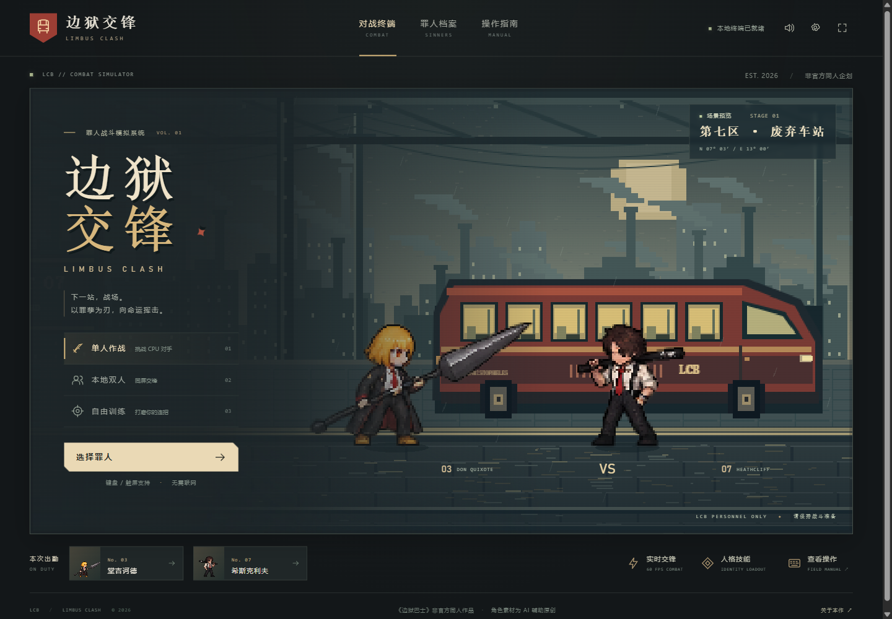
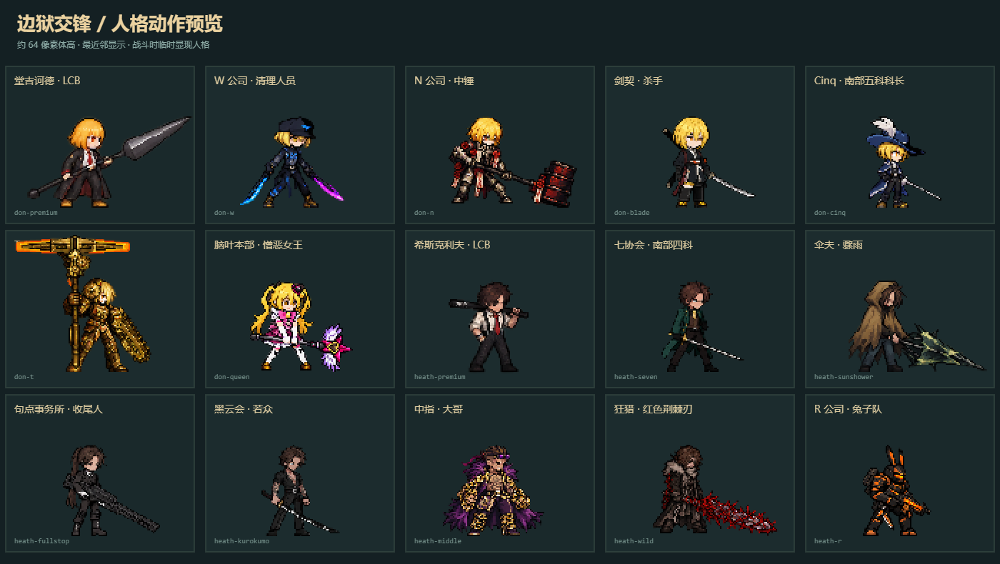

# 边狱交锋 · Limbus Clash

基于《Limbus Company》人物题材的**非官方同人横版像素格斗原型**。Phaser 3 + TypeScript + Vite，固定 60 Hz 战斗逻辑，无后端。角色与场景非官方素材，角色名称、世界观归原权利方所有。



手机安装、GitHub Desktop 发布与后续同步见 [手机 PWA 说明](docs/GITHUB-PAGES.md)。GitHub Desktop 仓库位置为 `D:\G\limbusbattle`。

## 启动

需要 Node.js 22.12+ 或 24+。

```sh
npm ci
npm run dev
```

打开终端显示的本地地址，点击「选择罪人 → 确认出勤」。开发服务器默认只监听本机。

```sh
npm run build       # 类型检查 + 生产构建，输出 dist/
npm run preview     # 预览生产包，默认 http://127.0.0.1:4173/
npm test            # 战斗核心测试
npx playwright install chromium  # 首次浏览器测试需准备 Chromium
npm run test:browser
```

已有 Chromium 时可设置环境变量 `PLAYWRIGHT_CHROMIUM_EXECUTABLE` 指向可执行文件。浏览器测试默认自动启动或复用 5173 端口的开发服务器。手机实机测试可运行 `npm run dev -- --host 0.0.0.0`，然后用同一局域网手机访问电脑 IP；PWA/Service Worker 需要 HTTPS 或 localhost。

## 默认按键

| 行动 | P1 | P2 |
|---|---|---|
| 左 / 右 | A / D | ← / → |
| 跳跃 / 下蹲 | W / S | ↑ / ↓ |
| 轻 / 中 / 重主武器攻击 | J / K / L | 小键盘 1 / 2 / 3 |
| 轻 / 中 / 重副武器攻击 | U / I / O | 小键盘 4 / 5 / 6 |
| E.G.O. | H | 小键盘 0 |
| 冲刺 | 左 Shift | 小键盘小数点 |
| 投 / 拆投 | Space | 小键盘 Enter |
| 防御 / 下段防御 | 后拉 / 斜下后 | 后拉 / 斜下后 |
| 暂停 | Esc | 共用 |
| 调试判定与帧数据 | F3 | 共用 |

在右上角设置中可重绑全部双人按键，冲突绑定会被拒绝。手机自动显示虚拟按键；设置中可强制开启并调整尺寸、水平内缩与底部高度。支持多指同时按住方向和攻击。

**武器普通技：** 每人六键，站立、下蹲、空中各六种；LCB 普通技保留各自武器：堂吉诃德长枪、希斯克利夫球棒、良秀带鞘长刀、默尔索金属拳套、以实玛利盾与钉头锤、罗佳大斧、李箱匕首、奥提斯曲刀、格里高尔附着虫臂。普通技不消耗资源。轻 → 中 → 重命中取消，L 为上挑，命中后 W 跳跃取消。冲刺中 J 为突进武器攻击。

**已确认的连段：** 近身 `J → K → L → 236J`（堂吉诃德） / `J → K → L → 214K`（希斯克利夫）；下段 `S+U → S+I → 人格技能`；低空 I 跳入 → 落地 J → K → 人格技能；L 命中 → W → 空中 J → K → 236J。动作要依次重新按下；命中顿帧期间也能提前输入下一招和搓招，普通技接触后的取消窗口保留到收招结束，空挥不能取消。详见 [操作与连段调整](docs/COMBAT-FLOW.md)。

**空战与防御：** 起跳确定水平速度，空中方向键和冲刺不能变轨。空中普通技向下延伸判定、同一按键每跳限一次，落地收招 4 帧；每跳允许一次空中人格技能（236J 或 214K）。后拉防御中段 / 跳入，斜下后防御下段；蹲防会被跳入打中。Space 为近身武器投，抓住后的 7 帧内 Space 拆投，后拉 + 投为背投。后走速度为前走的 65%；前冲 12 帧、速度 13，后撤 8 帧、速度 8。人格技能消耗罪孽，H 消耗 80；Tab 打开招式表。

手机六个武器普通技按钮支持真实搓招；「人格」展开快捷技能，跳起后切换为两个空中招式。旧版设置会迁移到新按键，原有自定义基础按键在不冲突时保留。

## 已实现

- 主菜单、十二罪人档案槽位、十二名可玩罪人、每人七个可配装地面搓招、两个空中搓招、十八种武器普通技、七十三套独立来源人格动作、选人/技能配装、两处场景、暂停、按键设置、结算与再战。
- 堂吉诃德：W、N、剑契、Cinq 南部五科科长、T、憎恶女王、LCB；希斯克利夫：句点、狂猎、七协、中指、黑云、伞夫、兔子队。每招有独立帧数据、服装和武器，招式结束或被打断后恢复 LCB。
- 新增良秀、默尔索、以实玛利、罗佳：每人六个指定来源人格、LCB 地面技能、两个空中人格技，以及独立的十八种武器普通技。人格清单与立绘来源见 [EXPANSION-REFERENCES.json](docs/EXPANSION-REFERENCES.json)。
- 武器修正：黄蜂默尔索以鸟枪发射单枚独头弹；惜春玛以折扇两次挥击；血魔公主罗佳使用可开合紫伞；拇指罗佳使用延长剑刃，远端判定随延刃生长，取消原射击。
- 新增李箱、奥提斯、格里高尔，各六人格、七地面 / 两空中指令。李箱镜痕延迟追击；奥提斯三发魔弹与可打断装填；格里高尔重虫臂蓄力增距，伸臂也可被击中。LCB 图稿按旧良秀比例重画。
- 新增浮士德、鸿璐、辛克莱，按堂吉诃德憎恶女王的像素精度制作，各有六套指定人格、七地面 / 两空中指令。浮士德重剑前摇诈势；鸿璐普通技命中滑步；辛克莱以血续接不同人格。十二人普通技有效与收招分别配置，完整比较见 [TWELVE-SINNER-GAMEPLAY.md](docs/TWELVE-SINNER-GAMEPLAY.md)。
- 普通技轻 / 中 / 重分三档刃迹、拖尾、持续时间、命中爆点和碎片密度。剪刀奥按强化帧修正硬血外刃、深色内刃、银环握柄与面具。
- 236J、214K、623L、22J、236K、214L、623J 七种面对方向指令；623 独立 40 帧窗口与 14 帧按键宽限，支持 636 / 323 简化；斜方向、输入窗口、左右镜像、招式优先级、输入缓存。手机和技能栏提供快捷按钮。
- 独立机制：W 三段突进、N 重锤破防、Cinq 快突刺、T 长硬直、剑契踏步拔刀、女王三段远程光束、LCB 升枪；句点单发狙击、狂猎荆棘刃重斩、七协防反、中指霸体拳、黑云二连刀、伞夫反击、兔子三连射。
- 60 Hz 固定逻辑、独立人物状态、单独 Hitbox/Hurtbox/Pushbox、前摇/有效/收招、命中去重、输入缓存、命中取消、武器轻中重取消、朝下的空中攻击、跳跃追击、固定跳跃轨迹、前后差速冲刺、浮空/倒地/起身无敌、墙角挤出。
- 后拉 / 斜下后防御、武器投 / 背投 / 七帧拆投、削血、架势耗尽破防、连击计数与伤害递减、Hitstop、震屏、火花、斩击轨迹、Web Audio 合成音效。
- 可关闭的攻击判定拼点、-45～45 SP、罪孽资源与 E.G.O.、灼烧持续伤害和破裂下次命中附伤。
- CPU 三档难度，使用同一输入与战斗接口，带反应延迟与失误；本地双人；无限时间和资源补充的训练模式。
- 键盘、多点触屏、全屏、安全区、16:9 对战画面、PWA Manifest、图标、生产包离线缓存。
- F3 判定/状态/帧数/速度/硬直调试与资源补充；素材工作台提供网格切片、动画预览和会话内换图。

## 结构

```text
src/core/          类型、世界参数、持久设置
src/combat/        Fighter 状态机、Match 规则/判定/资源/回合
src/characters/    Sinner/Identity 注册、人格变体
src/data/          JSON 人格、技能、Hitbox、取消窗口
src/ai/            延迟观察 CPU
src/input/         独立键盘输入、多指触屏、面对方向搓招识别
src/skills/        招式目录、指令与技能配装
src/scenes/        Phaser 场景与固定步长调度、摄像机、战斗渲染
src/assets/        原创背景生成、素材加载、Sprite Sheet/序列/Aseprite 接口
src/audio/         程序化音效
src/effects/       按招式阶段绘制的分层特效、残影、粒子
src/platform/      PWA 安装/更新、全屏/横屏与屏幕常亮
src/ui/            菜单、选人、HUD、设置、素材工作台
public/characters/{sinner}/{persona}/  保留的原图、对齐精灵表、帧映射
public/runtime/    小体积运行资源、图标与预编译像素帧
tests/             核心规则与 Playwright 浏览器测试
docs/              参考研究、素材提示词、验收记录、截图
```

`Match` 和 `Fighter` 不依赖 Phaser、DOM 或真实时钟。渲染只读取状态；CPU 与人类使用相同的 `InputFrame`。每次有效攻击有独立序号和命中过的目标集合。判定按人物朝向镜像，与可见人物矩形分离。

## 十二名罪人的特点

十二位完整主打法、机制限制、帧数据与应对表见 [TWELVE-SINNER-GAMEPLAY.md](docs/TWELVE-SINNER-GAMEPLAY.md)，游戏内「罪人档案」也可查看。浮士德、鸿璐、辛克莱分别侧重诈势、滑步和血续势；李箱、奥提斯、格里高尔分别侧重镜痕、弹药和可打伸臂。

特点会影响实际伤害、硬直、投技或前摇；选人页显示用途与弱点，对战 HUD 显示状态。

| 罪人 | 特点 | 使用方式 |
|---|---|---|
| 堂吉诃德 | 枪尖：普通技外侧 35% 伤害 +15%、硬直 +4 帧 | 用长枪与前冲维持间距 |
| 希斯克利夫 | 怒意：受击积累最多三层，重击 / 人格接触时每层伤害 +8%、削架势 +15% | 受压后确认一次重击；四秒无新增怒意则消退 |
| 良秀 | 见切：抓对手收招，伤害 +20%、硬直 +6 帧 | 刀鞘差合与踏步确反 |
| 默尔索 | 稳固：格挡积累三层，成功投技每层多 20 基础伤害 | 短手慢走，近身投距与回报更强 |
| 以实玛利 | 盾反：格挡后 90 帧内，下次攻击前摇 -2 帧、伤害 +15% | 防守后抢回合，空挥也会消耗 |
| 罗佳 | 豪赌：同一连段用不同普通技攒三层，下次地面人格伤害 +25%、削架势 ×1.8 | 用不同斧技确认后破阵，强化招空挥也消耗 |

新增四人都具备 `J → K → L → 人格技能` 的连续命中路线：良秀接 `623L`，默尔索接 `214K`，以实玛利与罗佳接 `236J`。

## 新增人格技能

`src/data/command-skills.json` 定义招式。必填 `sinner/slot/id/name/source/appearance`，以及 `startup/active/recovery`（60 Hz 帧）、伤害、硬直、资源、冷却、局部 `box` 和取消窗口。方向槽位取 `qcf/qcb/dp/ddj/qcfk/qcbl/dpj`；同槽的多个技能自动进入配装菜单。空中招式单独定义在 `src/data/air-skills.json`，默认配置在 `src/skills/catalog.ts`，用户配置按玩家分别存入本机。

`hits` 定义独立命中窗口及伤害系数；`projectile` 定义发射帧/速度/尺寸/寿命；`extend` 定义近段与全长剑刃判定，随有效帧伸长；`counter` 是防反帧窗口；`armorUntil` 是霸体截止帧；`teleport` 是首个有效帧的踏步距离。所有机制均由战斗核心处理。

`src/data/persona-art.json` 登记人格贴图。放置对应 `fighter.png/frames.json`，招式 `visualKey` 指向该键。每套六姿势由前摇、有效、收招阶段驱动。渲染只在攻击期间选用该人格，基础人物始终 LCB。加入其他罪人还需注册基础数据及其动作素材。

| 指令（朝向对手） | 堂吉诃德 | 希斯克利夫 |
|---|---|---|
| 236 J | W · 空间撕裂 | 句点 · 集中射击 |
| 214 K | N · 钉锤净化 | 狂猎 · 葬送 |
| 623 L | Cinq · 决斗突刺 | 七协 · 弱点识破 |
| 22 J | T · 时间征收 | 中指 · 清算之拳 |
| 236 K | 剑契 · 拔刀 | 黑云 · 拔刀斩 |
| 214 L | 憎恶女王 · 以爱与憎之名 | 伞夫 · 雨中反击 |
| 623 J | LCB · 正义升枪 | 兔子队 · 快速压制 |

| 指令 | 良秀 | 默尔索 | 以实玛利 | 罗佳 |
|---|---|---|---|---|
| 236 J | 贴身破阵弹 | 铁拳·寸焰 | 四协·断流 | 钉锤·罪痕 |
| 214 K | 齿轮重落 | 剑契·导师斩 | 心灵·震荡 | 十协·破书拳 |
| 623 L | 迎宾·清扫 | 决斗·截空 | 船长·刺鲸 | 公主·紫伞轮舞 |
| 22 J | 蔑视的延刃 | 炮刃·轰断 | 二协·迎击 | 黑兽·蛇行三叠斩 |
| 236 K | 鸿园·追刺 | 王子·血缚投 | 惜春·展扇拂袖 | 环指·兽爪涂抹 |
| 214 L | 鞋履馆·踏碎 | 黄蜂·独头弹 | OSIR·鬼火拔刀 | 拇指·延刃断击 |
| 623 J | 鞘锋·升击 | 拳套·固守反击 | 盾锤·截浪 | 大斧·迎面挑 |

236J 朝右示例：S → 按住 S+D → 松开 S 保持 D → J。623L：D → S → S+D → L。22J：S → 松开 → S → J。整套输入窗口为 34 帧（约 0.57 秒），相邻关键方向最多间隔 16 帧，末尾方向后按键允许 12 帧（约 0.2 秒）容错，均包含在整体窗口内。完整 236 / 214 后轻微回拨到斜下，以及 623 后顺势推到前方，也能识别；仍需完成斜方向，单纯下蹲或前走不会变成人格技能。朝左镜像。P2 用方向键及小键盘 1/2/3 代替 J/K/L。



## 替换精灵与声音

内置角色为参考原作立绘重新制作的 AI 辅助衍生动作，LCB 原图各 18 姿势（打包为 36 运行帧）、73 套人格各 6 姿势。构建素材时统一采样到约 64 像素体高，最近邻显示；待机固定首帧，位置按像素网格显示。低分辨率头像与实战人物保持一致。实际发布的帧位于 `public/runtime/characters`，原图不随网页加载。新武器普通技各有 18 个接触姿势，记录见 [WEAPON-NORMALS-ART.md](docs/WEAPON-NORMALS-ART.md)。后续十名罪人每人分两张基础原图生成（各 18 姿势），每个人格再单独生成六姿势小表，记录见 [EXPANSION-ART-PROMPTS.md](docs/EXPANSION-ART-PROMPTS.md)。素材记录见 [LCB-ART-PROMPTS.md](docs/LCB-ART-PROMPTS.md) 和 [PERSONA-ART-PROMPTS.md](docs/PERSONA-ART-PROMPTS.md)。三人武器研究和制作见 [NEXT-THREE-RESEARCH.md](docs/NEXT-THREE-RESEARCH.md)，最终图稿记录见 [NEXT-THREE-ART-PROMPTS.md](docs/NEXT-THREE-ART-PROMPTS.md)。最后三位以用户给定小唐憎恶女王为精度参考，研究与提示词见 [FINAL-THREE-RESEARCH.md](docs/FINAL-THREE-RESEARCH.md) 和 [FINAL-THREE-ART-PROMPTS.md](docs/FINAL-THREE-ART-PROMPTS.md)。最新只修 LCB：八人基础图重制，四人保留原图；人格换装图原样保留。小唐和希斯克利夫各有独立风格定稿，记录与重建命令见 [LCB-ART-REFINEMENT.md](docs/LCB-ART-REFINEMENT.md)。对齐脚本需要 Python + Pillow，仅用于重新制作素材，日常运行不需要 Python。

在「关于本作 → 素材预览与导入」或设置中打开素材工作台，可先选择人格预览其专属六姿势，再选择基础目标人物，加载 PNG，设置帧宽高，预览后应用。等宽网格逐行切片；可附加 Aseprite JSON，使用与 `idle/run/jump/fall/attack/hit/guard/down/win` 等状态同名的 `frameTags`。上传素材仅本次会话有效，刷新会恢复内置素材。

需要发布的资源放在 `public/runtime`。长期接入在场景 `preload` 中调用 `AssetManager.queue()`，加载后 `defineAnimations()` 并 `bindIdentity()`。支持：

```ts
AssetManager.queue(scene, {
  key: 'my-don', type: 'sheet', url: './characters/don/my-id/idle.png',
  frameWidth: 96, frameHeight: 96,
  animations: { idle: {frames:[0,1,2,3],fps:10,loop:true} }
});
// Loader 完成之后：
AssetManager.defineAnimations(scene, definition);
AssetManager.bindIdentity(identity, 'my-don', 2, 0.94);
```

`type: 'sequence'` 使用 `urls` 数组；`aseprite` 使用 PNG `url` 和 JSON `json`；`audio` 使用 WAV/OGG/MP3 的 URL 数组；`effect` 使用与 sheet 一样的帧尺寸。声音加载接口已预留，当前实战使用合成音效；自定义声音需自行接入 `Synth` 或音频播放器。

## 离线与交付

`dist/` 是完整静态 PWA 包，离线预缓存约 9 MiB。内置安装入口、Android 安装提示、iOS 添加主屏幕说明、横屏启动、离线就绪状态和安全更新。支持时请求全屏/方向锁定/屏幕常亮，不支持时使用手动旋屏提示。开发版不注册 Service Worker。

GitHub Pages 工作流已配置，支持 `main/master` 及仓库子路径。首次发布需在 GitHub 设置 Pages Source 为 GitHub Actions，具体见 [手机 PWA 说明](docs/GITHUB-PAGES.md)。项目没有自动提交或推送；后续完成改动后运行 `npm run sync:repo` 同步到用户仓库。

特效独立于战斗判定：前摇蓄力、人格纹章、分层斩击、空间裂缝、齿轮时钟、荆棘、星心光束、命中碎片、地面冲击和冲刺残影。瞬时特效有数量上限和生命周期，受击短闪约 65 ms，避免整段硬直都变成白色剪影。

参考项目的许可证与静态核查见 [RESEARCH.md](docs/RESEARCH.md)，测试证据见 [VALIDATION.md](docs/VALIDATION.md)。本工程未复制参考仓库的源代码或角色/音频素材。

## 当前限制

- 属于可玩原型。没有联网对战、回滚同步、剧情或正式游戏资源。
- 基础人物奔跑/攻击各 6 姿势，反应动作多为单姿势；73 套来源人格各有专属六姿势。人格动作是生成图经对齐采样后播放，尚无逐帧手工修形、完整转身或商业级动画连续性；普通技各有独立接触姿势，前摇 / 收招仍复用基础姿势，E.G.O. 继续使用基础挥击。
- 招式是原作人格的格斗化改编，帧数据、伤害、资源和机制服务本作平衡。没有完整复刻原作硬币、被动、弹药、充能、沉沦等系统。
- 手机已用 Chromium 触屏模拟验证；没有实体 iPhone/Android、多浏览器及低端机性能实测。PWA 安装入口与音频限制因浏览器而异。
- 素材工作台更换只保留当前会话；帧编辑/Hitbox 可视化编辑器、完整音效映射、自由拖拽按钮暂未实现。
- 场景为原创程序化像素背景，人物为 AI 辅助原创衍生图；未使用官方精灵。对战体验与美术仍可继续打磨。

十二人已实装；早期腹稿保存在 [ROSTER-PLAN.md](docs/ROSTER-PLAN.md)，实际最终招式以 JSON、游戏招式表和 [TWELVE-SINNER-GAMEPLAY.md](docs/TWELVE-SINNER-GAMEPLAY.md) 为准。
