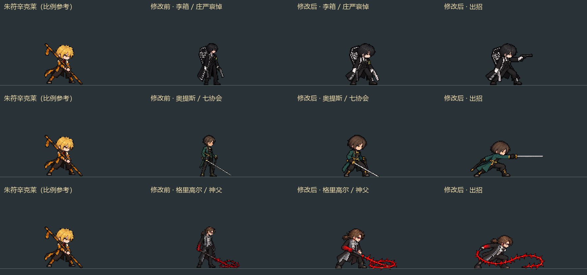

# 人格人体比例普查与修正

2026-10-25。根据用户要求，继续检查除 T 奥提斯外是否有头脸过小、四肢细长、切换时身体缩小的同类问题。对 73 套人格的准备姿势和攻击接触姿势作同尺度横向检查，人体参考为已经接入的朱符辛克莱。

## 处理结果

- 17 套重画六姿势：李箱全部六套，奥提斯其余五套，格里高尔全部六套。缩短过长躯干和四肢，恢复头肩宽度、前臂和靴子的体积，按朱符约三头身的紧凑轮廓绘制。人格服装和武器辨识沿用已有源图。
- 9 套只改打包尺度/身体列锚点：Cinq 唐、R 兔希斯克利夫、剑契默尔索、Cinq 默尔索、黄蜂默尔索、裴廓德船长以实玛利、黑兽罗佳、Cinq 鸿璐、流浪乐队辛克莱。这些人体本身可用，帽子、羽毛或兔耳占据额外高度，旧等高缩放把身体压小。
- 其余 47 套人格的源图、对齐图和运行图保持原哈希，包括此前已经修好的 T 奥提斯。十二人的 LCB 和普通技 24 张运行图均与修改前上传目录逐字节相同。

## 打包修正

长枪、长柄刀、鞭子超出旧 800×640 中间画布时会提前截断，最终运行图甚至看不出贴边。`prepare-personas.py` 现在先计算所有动作相对身体锚点的完整范围，再按需要扩大透明画布；不分别拉伸头/躯干，不改武器大小。

黑兽李箱与神父格里高尔需要较长的横向空间，运行帧扩大到 320×128，另 95 张图集仍用 224×128。加载器、备用 Canvas 转换和素材预览读取宽度；身体仍位于水平中点、脚底 y=116，人物缩放、朝向和战斗判定沿用原设置。没有为了塞入长武器再缩小身体。

理发师奥提斯和埃德加格里高尔的生成结果实际为三列两行，已按实际布局切片；完整提示词保留原始两列三行要求，不篡改生成记录。

## 核对

- 97 张运行图集、1086 帧：0 空帧、0 边缘裁切；本次26套中间画布也没有超出边界。
- 源图仅17套改变，运行图仅26套改变；哈希清单见 [PERSONA-PROPORTION-ASSETS.json](PERSONA-PROPORTION-ASSETS.json)。
- 浏览器十二人108个地面/空中招式的前摇、有效、收招与持续运行通过，无页面错误；包含两张扩展宽度图集。`npm run build`通过，PWA121项预缓存9411.75KiB。
- 这是美术和打包修正，没有更改招式机制、数值或特效；本轮未重复运行全部战斗单测。

对比图：

[准备姿势总览](screenshots/persona-proportion-ready-audit.png) · [攻击姿势总览](screenshots/persona-proportion-attack-audit.png)

生成方式为内置 `image_gen` 图像编辑，逐人格生成独立六姿势图；参考1朱符控制像素精度和人体比例，参考2本人格旧图控制身份服装、武器与动作。源图原样保存于 `public/characters/<sinner>/<persona>/source-sheet.png`，后续只透明遮罩、切片、平移对齐和全人物等比最近邻采样。完整最终提示词见 [PERSONA-PROPORTION-PROMPTS.md](PERSONA-PROPORTION-PROMPTS.md)。

## 全部73套检查结论

| 标识 | 人格 | 处理 |
| --- | --- | --- |
| don-w | W 公司 · 清理人员 | 保留原图 |
| don-n | N 公司 · 中锤 | 保留原图 |
| don-blade | 剑契 · 杀手 | 保留原图 |
| don-cinq | Cinq 协会 · 南部五科科长 | 仅尺度/锚点修正 |
| don-t | T 公司 · 三级征收员工 | 保留原图 |
| don-queen | 脑叶本部 · 憎恶女王 | 保留原图 |
| heath-seven | 七协会 · 南部四科 | 保留原图 |
| heath-sunshower | 脑叶 E.G.O. · 伞夫 | 保留原图 |
| heath-fullstop | 句点事务所 · 收尾人 | 保留原图 |
| heath-kurokumo | 黑云会 · 若众 | 保留原图 |
| heath-middle | 中指 · 大哥 | 保留原图 |
| heath-wild | 荒猎 · 希斯克利夫 | 保留原图 |
| heath-r | R 公司 · 兔子队 | 仅尺度/锚点修正 |
| ryoshu-lccb | LCCB 助理 | 保留原图 |
| ryoshu-yuro | 二十区 · 圣愚会 | 保留原图 |
| ryoshu-edgar | 埃德加家族 · 首席管家 | 保留原图 |
| ryoshu-n | N 公司 E.G.O. · 蔑视，敬畏 | 保留原图 |
| ryoshu-hongyuan | 鸿园 · 流浪武者 | 保留原图 |
| ryoshu-couture | 西西弗百货 · 黑派鞋履馆 | 保留原图 |
| meur-liu | 六协会 · 南部六科 | 保留原图 |
| meur-blade | 剑契 · 导师 | 仅尺度/锚点修正 |
| meur-cinq | Cinq 协会 · 西部三科 | 仅尺度/锚点修正 |
| meur-thumb | 拇指 · 东部四级指挥官 | 保留原图 |
| meur-prince | 拉曼却领 · 王子 | 保留原图 |
| meur-hornet | 脑叶 E.G.O. · 黄蜂〔改造〕 | 仅尺度/锚点修正 |
| ish-shi | 四协会 · 南部五科 | 保留原图 |
| ish-r | R 公司 · 驯鹿队 | 保留原图 |
| ish-pequod | 裴廓德号 · 船长 | 仅尺度/锚点修正 |
| ish-zwei | 二协会 · 西部三科 | 保留原图 |
| ish-hierarch | H 公司 · 家主候选人 | 保留原图 |
| ish-lcd | LCD · OSIR 小队 | 保留原图 |
| rod-n | N 公司 · 中锤 | 保留原图 |
| rod-dieci | 十协会 · 南部四科 | 保留原图 |
| rod-princess | 拉曼却领 · 公主 | 保留原图 |
| rod-heishou | 黑兽 · 巳 | 仅尺度/锚点修正 |
| rod-ring | 环指 · 野兽派讲师 | 保留原图 |
| rod-thumb | 蜘蛛巢 · 拇指教父 | 保留原图 |
| yi-spicebush | 东柏 · 香辛料 | 六姿势人体重画 |
| yi-solemn | 脑叶 E.G.O. · 庄严哀悼 | 六姿势人体重画 |
| yi-ring | 环指 · 点彩派学生 | 六姿势人体重画 |
| yi-w | W 公司 · 三级清理人员 | 六姿势人体重画 |
| yi-wu | 黑兽 · 午支部精锐 | 六姿势人体重画 |
| yi-dimension | LCE E.G.O. · 裂维者 | 六姿势人体重画 |
| outis-magic | 脑叶 E.G.O. · 魔弹 | 六姿势人体重画 |
| outis-w | W 公司 · 三级清理组长 | 六姿势人体重画 |
| outis-seven | 七协会 · 南部六科科长 | 六姿势人体重画 |
| outis-middle | 蜘蛛巢 · 中指养父 | 六姿势人体重画 |
| outis-barber | 拉曼却领 · 理发师 | 六姿势人体重画 |
| outis-t | T 公司 · 三级 VDCU 职员 | 保留原图 |
| greg-g | G 公司 · 经理级代理 | 六姿势人体重画 |
| greg-firefist | 炎拳事务所 · 幸存者 | 六姿势人体重画 |
| greg-pirate | 双钩海盗团 · 大副 | 六姿势人体重画 |
| greg-edgar | 埃德加家族 · 继承人 | 六姿势人体重画 |
| greg-priest | 拉曼却领 · 神父 | 六姿势人体重画 |
| greg-aedd | LCE E.G.O. · AEDD | 六姿势人体重画 |
| faust-remnant | 脑叶公司支部 · 残余 | 保留原图 |
| faust-butler | 呼啸山庄 · 管家 | 保留原图 |
| faust-n | N 公司 · 执握者 | 保留原图 |
| faust-multicrack | 多裂纹事务所 · 代表 | 保留原图 |
| faust-heishou | 黑兽 · 卯支部熟练者 | 保留原图 |
| faust-ring | 蜘蛛之屋 · 环指学徒 | 保留原图 |
| hong-liu | 六协会 · 南部五科 | 保留原图 |
| hong-k | K 公司 · 三级摘除员工 | 保留原图 |
| hong-fullstop | 句点事务所 · 代表 | 保留原图 |
| hong-h | 鸿园之主 | 保留原图 |
| hong-s | S 公司 · 推奴 | 保留原图 |
| hong-cinq | Cinq 协会 · 东部三科 | 仅尺度/锚点修正 |
| sin-mariachi | 流浪乐队 · 首领 | 仅尺度/锚点修正 |
| sin-redsheet | 脑叶 E.G.O. · 朱符 | 保留原图 |
| sin-cinq | Cinq 协会 · 南部四科科长 | 保留原图 |
| sin-devyat | 九协会 · 北部三科 | 保留原图 |
| sin-pinky | 蜘蛛之屋 · 小指学徒 | 保留原图 |
| sin-crimson | 西西弗 · 赤红之神 | 保留原图 |

## 重建

```powershell
python scripts/prepare-personas.py yi-spicebush yi-solemn yi-ring yi-w yi-wu yi-dimension outis-magic outis-w outis-seven outis-middle outis-barber greg-g greg-firefist greg-pirate greg-edgar greg-priest greg-aedd don-cinq heath-r meur-blade meur-cinq meur-hornet ish-pequod rod-heishou hong-cinq sin-mariachi
python scripts/build-pixel-atlases.py
npm run build
```
